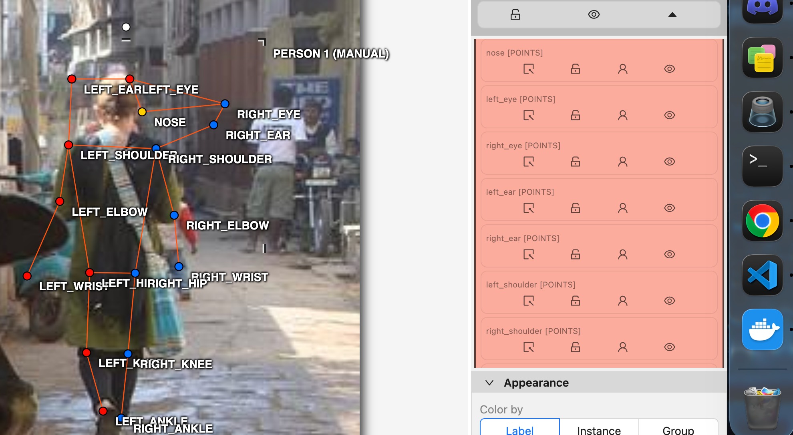
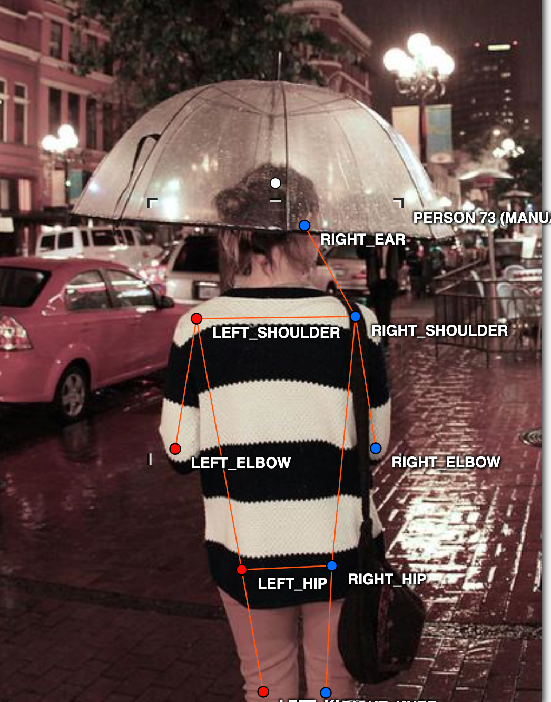
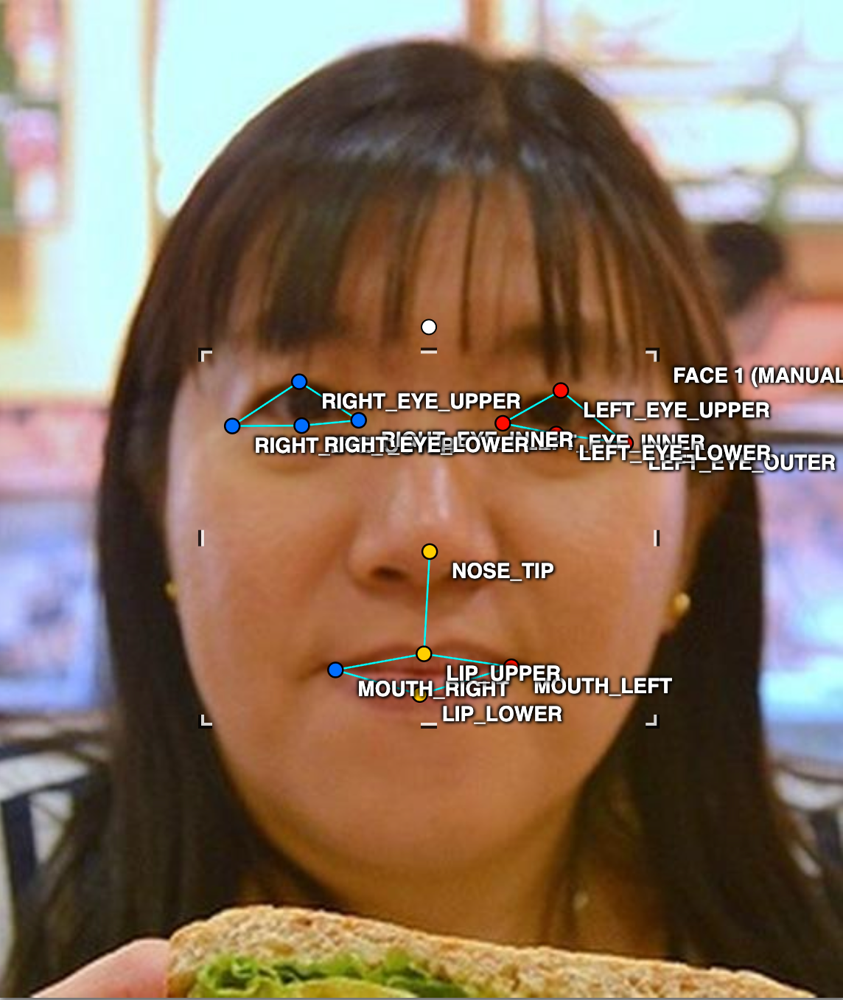
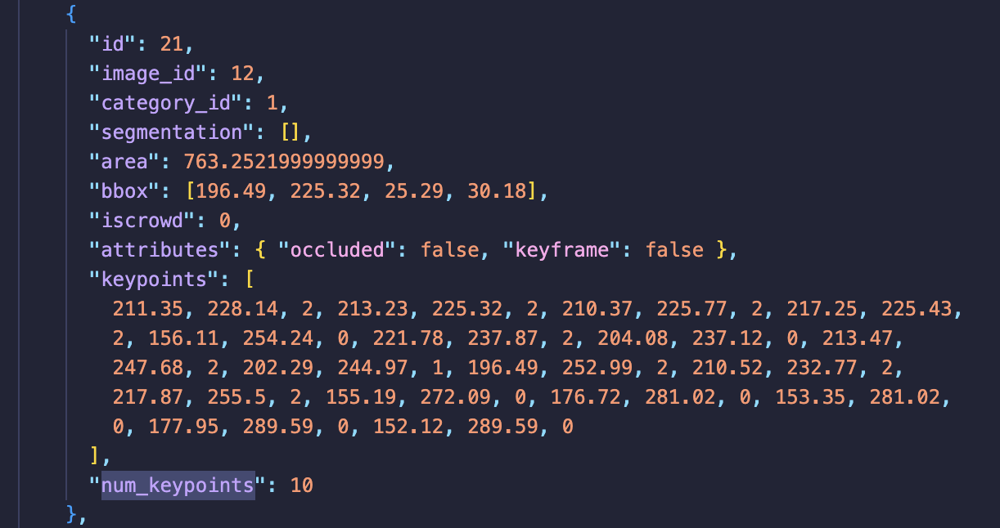

# Báo cáo cá nhân — HoVaTen-MSSV

Đổi tên file theo quy tắc `MSSV_HoTen.md`. Ví dụ: `20241234_NguyenVanAn.md`.

Dữ liệu: 12 ảnh người COCO val2017 (Lin et al., 2014) và 8 ảnh chân dung Wikimedia Commons, chỉ dùng trong lớp.

## 0. Thông tin học viên

- Họ tên:Hoàng Quảng Quyền
- MSSV: 2A202603082
- Email:26ai.quyenhq@vinuni.edu.vn
- Link repository:https://github.com/quyenhoang0712/K5-L2-DAY04-HoangQuangQuyen-2A202603082-KeypointPose
- Phiên bản CVAT (Help → About):2.82.1
- Máy: macOS · MacBook Pro M1 · RAM 8 GB · chạy CVAT chế độ Lite
- Bộ ảnh (`src/exports/assignment.json` do `lab.py setup` tạo): có
- Giờ bắt đầu: 17:00
- Giờ kết thúc: 18:35

## 1. Kiểm tra label (CP0)

| Label | Kiểu | Số điểm | Tên điểm đúng bảng của lab? | Đúng thứ tự? | Số cạnh |
|---|---|---:|---|---|---:|
| `person` | Skeleton | 17 | Có | Có | 19 |
| `face` | Skeleton | 13 | Có | Có | 13 |

Mẫu `person` dựng theo người quay mặt về camera (các điểm `left_*` nằm bên phải khung mẫu)? **Có**

Cách đổi cờ `occluded` / `outside` cho **một điểm** trên phiên bản CVAT này:

Chọn điểm cần chỉnh trong Skeleton, sử dụng biểu tượng Occluded để đặt `v = 1` khi điểm bị che nhưng có thể ước lượng vị trí, hoặc biểu tượng Outside để đặt `v = 0` khi điểm nằm ngoài ảnh hay không thể xác định vị trí. Thao tác chỉ áp dụng cho điểm được chọn.

...

## 2. Số lượng đã gán và thời gian (CP1, CP2)

|## 2. Số lượng đã gán và thời gian (CP1, CP2)

| Nhóm ảnh | Số ảnh | Số skeleton đã gán | Số người dưới 60 px (không gán) | Số poster / gương / màn hình bỏ qua | Thời gian (phút) |
|---|---:|---:|---|---|---|
| `easy` | 5 | 5 | Chưa thống kê | Chưa thống kê | Chưa ghi |
| `occluded` | 3 | 6 | Chưa thống kê | Chưa thống kê | Chưa ghi |
| `back` | 2 | 5 | Chưa thống kê | Chưa thống kê | Chưa ghi |
| `small` | 1 | 5 | Chưa thống kê | Chưa thống kê | Chưa ghi |
| `crowd` | 1 | 3 | Chưa thống kê | Chưa thống kê | Chưa ghi |
| `faces` | 8 | 8 | — | Chưa thống kê | Chưa ghi |
| **Tổng** | **20** | **32** | | | |

- Giờ bắt đầu: 17:00
- Giờ kết thúc: 18:35
- Tổng thời gian thực hiện: 95 phút

- Số ảnh người đã xong ở mốc phút 105: Không áp dụng (tổng thời gian thực tế 95 phút).
- Thời gian thực tế (phút): CP1 65 phút · CP2 20 phút · CP3 10 phút
- Ảnh tốn thời gian nhất: [000000572411.jpg]
## 3. Bảng ca khó (CP1, CP2)

Mỗi điểm bạn phân vân một dòng, nhất là phân vân giữa `v = 1` và `v = 0`, hoặc không chắc hướng người.

| Ảnh | Người / mặt | Điểm | Cờ đã chọn | Phân vân giữa | Lý do chọn |
|---|---|---|---|---|---|
| `000000023424.jpg` | Người quay lưng | `left_ear` | [Điền cờ thực tế] | `v = 0` và `v = 1` | [Ghi tai trái bị che đến mức nào và có xác định được vị trí hay không] |
| `000000023424.jpg` | Người quay lưng | `right_ear` | [Điền cờ thực tế] | `v = 0` và `v = 1` | [Ghi tai phải có lộ ra hay bị tóc che, lý do chọn cờ] |

## 4. Bảng tự review (CP3)

Đi từ ảnh cuối về ảnh đầu. 5 ảnh người (ít nhất 2 ảnh `back` hoặc `crowd`) và 3 ảnh mặt. Ít nhất 8 dòng, kể cả dòng `ok`. Ghi lỗi trước, sửa sau.

Mã lỗi dùng đúng một trong: `lr_swap`, `vis_flag`, `position`, `missing`, `extra`, `ok`.

## 4. Bảng tự review (CP3)

| Ảnh | Người / mặt | Điểm | Mã lỗi | Ghi chú | Đã sửa? |
|---|---|---|---|---|---|
| `000000023424.jpg` | Người quay lưng | Vai, mắt, tai | [Kiểm tra] | Kiểm tra hướng trái/phải và các điểm bị che | [Điền] |
| `000000043719.jpg` | Người quay lưng | Các khớp trái/phải | [Kiểm tra] | Kiểm tra hướng cơ thể và vị trí khớp | [Điền] |
| `000000413160.jpg` | Người trong đám đông | Các khớp bị che | [Kiểm tra] | Kiểm tra có nhầm khớp giữa các người không | [Điền] |
| `000000043968.jpg` | Người #1 | Hip, knee, ankle | [Kiểm tra] | Script cảnh báo các cặp khớp có thể bị đảo trái/phải | [Điền] |
| `000000188804.jpg` | Người #2 | Ankle | [Kiểm tra] | Script cảnh báo cặp cổ chân ngược phía | [Điền] |
| `face_204787` | Mặt #1 | Mắt, mũi, miệng | [Kiểm tra] | Kiểm tra vị trí 13 điểm | [Điền] |
| `face_257657` | Mặt #1 | Mí mắt | [Kiểm tra] | Kiểm tra mí trên và mí dưới | [Điền] |
| `face_405456` | Mặt #1 | Mắt, khóe miệng | [Kiểm tra] | Kiểm tra vị trí và hướng trái/phải | [Điền] |

Tổng hợp số lỗi theo mã:


| `lr_swap` | `vis_flag` | `position` | `missing` | `extra` | `ok` |
|---:|---:|---:|---:|---:|---:|
| [ ] | [ ] | [ ] | [ ] | [ ] | [ ] |

Điểm còn phân vân giữa `v = 1` và `v = 0`:

Trong quá trình gán nhãn, tôi gặp khó khăn khi xác định vị trí `left_ear` và `right_ear` của người quay lưng trong ảnh `000000023424.jpg`, do tóc che khuất một phần hoặc toàn bộ tai.

Tôi cân nhắc giữa `v = 1` (tai bị che nhưng có thể ước lượng vị trí khá chắc) và `v = 0` (không đủ thông tin xác định vị trí). Tôi ưu tiên không đoán bừa nhằm tránh tạo ra keypoint sai, đồng thời kiểm tra từng tai trước khi quyết định đặt cờ visibility.

Cờ thực tế đã chọn: [Điền `v` của từng tai sau khi kiểm tra CVAT].

## 5. Kiểm file xuất và kết quả tự kiểm (CP4)

Tự kiểm tay trong file JSON:

|## 5. Kiểm file xuất và kết quả tự kiểm (CP4)

Tự kiểm tay trong file JSON:

| File | Người / mặt kiểm (ảnh, thứ tự) | Số phần tử `keypoints` | Điểm `outside` ra `v = 0`, `occluded` ra `v = 1`? | `num_keypoints` khớp? |
|---|---|---:|---|---|
| `HoangQuangQuyen_persons.zip` | `000000023424.jpg`, người #1 | 51 | Chưa đối chiếu tay | Script xác nhận |
| `HoangQuangQuyen_persons.zip` | `000000043968.jpg`, người #1 | 51 | Chưa đối chiếu tay | Script xác nhận |
| `HoangQuangQuyen_faces.zip` | `face_204787`, mặt #1 | 39 | Chưa đối chiếu tay | Script xác nhận |

Sau khi xuất, CVAT ghi `occluded` thành `v = 1` và `outside` thành `v = 0`.

Tọa độ của điểm `outside` trong file: CVAT 2.x vẫn giữ tọa độ cũ. Script ghi nhận 145 điểm `v = 0` mang tọa độ cũ. Đây không phải lỗi vì những điểm này được bỏ qua khi huấn luyện và chấm.

Hai job đã chuyển sang completed trên CVAT? Có  **[Có / Không — kiểm tra trên CVAT]**

### TÓM TẮT từ src/check_submission.py

**File person: HoangQuangQuyen_persons.zip**

- Số ảnh: 12
- Số skeleton `person`: 24
- Mỗi annotation: 51 số
- Skeleton theo ảnh:
  - `000000023424`: 4
  - `000000043719`: 1
  - `000000043968`: 1
  - `000000072098`: 1
  - `000000103970`: 1
  - `000000137767`: 1
  - `000000157271`: 2
  - `000000188804`: 2
  - `000000205650`: 1
  - `000000311497`: 2
  - `000000413160`: 3
  - `000000572411`: 5
- Cờ v: `v=2`: 256 (63%); `v=1`: 23 (6%); `v=0`: 129 (32%)
- `num_keypoints` trung bình: 11.6

**File face: HoangQuangQuyen_faces.zip**

- Số ảnh: 8
- Số skeleton `face`: 8
- Mỗi annotation: 39 số
- Skeleton theo ảnh: `face_204787=1`, `face_257657=1`, `face_405456=1`, `face_415073=1`, `face_449454=1`, `face_496353=1`, `face_514826=1`, `face_560526=1`
- Cờ v: `v=2`: 88 (85%); `v=1`: 0 (0%); `v=0`: 16 (15%)
- `num_keypoints` trung bình: 11.0

**Kết quả tự kiểm:**

- Số lỗi: 0
- Số cảnh báo: 8
- Kết quả: **ĐẠT**

### Các cảnh báo cần kiểm tra

1. `000000023424.jpg`: Người #1 và #2 có độ trải keypoint dưới 60 px.
2. `000000043968.jpg`: Người #1 có cảnh báo thứ tự trái/phải ở hông, gối và cổ chân.
3. `000000188804.jpg`: Người #2 có cảnh báo cặp cổ chân.
4. `000000311497.jpg`: Người #2 có cảnh báo cặp gối và cổ chân.
5. `000000572411.jpg`: Người #1, #2 và #5 có độ trải keypoint dưới 60 px.

Các cảnh báo về kích thước cần đối chiếu chiều cao người trong ảnh gốc. Những cảnh báo trái/phải cần kiểm tra xem có thực sự bị đảo điểm hay là do tư thế bắt chéo chân.

Tình trạng xử lý cảnh báo: [Ghi những cảnh báo đã kiểm tra và lý do sửa hoặc giữ nguyên].

```text
(dán ở đây)
- File person: HoangQuangQuyen_persons.zip
  Số ảnh: 12 · số skeleton `person`: 24 · mỗi annotation 51 số
  Skeleton theo ảnh: 000000023424=4, 000000043719=1, 000000043968=1, 000000072098=1, 000000103970=1, 000000137767=1, 000000157271=2, 000000188804=2, 000000205650=1, 000000311497=2, 000000413160=3, 000000572411=5
  Cờ v: v=2 256 (63%) · v=1 23 (6%) · v=0 129 (32%)
  num_keypoints trung bình: 11.6
- File face: HoangQuangQuyen_faces.zip
  Số ảnh: 8 · số skeleton `face`: 8 · mỗi annotation 39 số
  Skeleton theo ảnh: face_204787=1, face_257657=1, face_405456=1, face_415073=1, face_449454=1, face_496353=1, face_514826=1, face_560526=1
  Cờ v: v=2 88 (85%) · v=1 0 (0%) · v=0 16 (15%)
  num_keypoints trung bình: 11.0
- Ghi chú: 145 điểm v = 0 vẫn mang tọa độ cũ (CVAT 2.x xuất như vậy; chuẩn COCO ghi 0, 0). Không phải lỗi: điểm v = 0 bị bỏ qua khi huấn luyện và khi chấm.
- Số [LỖI]: 0 · số [CẢNH BÁO]: 8
```

Các `[CẢNH BÁO]` còn giữ nguyên và lý do:
  [CẢNH BÁO] 000000043968.jpg #1: cặp hip, knee, ankle nằm ngược phía so với các cặp còn lại. Có thể đổi trái/phải một cặp (`lr_swap`), hoặc tay / chân bắt chéo thật: kiểm lại. 
Lý do: tại nó xoay người
  [CẢNH BÁO] 000000188804.jpg #2: cặp ankle nằm ngược phía so với các cặp còn lại. Có thể đổi trái/phải một cặp (`lr_swap`), hoặc tay / chân bắt chéo thật: kiểm lại.
Lý do: tại  bắt chéo chân
  [CẢNH BÁO] 000000311497.jpg #2: cặp knee, ankle nằm ngược phía so với các cặp còn lại. Có thể đổi trái/phải một cặp (`lr_swap`), hoặc tay / chân bắt chéo thật: kiểm lại.
tại cũng bắt chéo chân
...

## 6. Ảnh chụp màn hình

1. Label `person` trong label constructor (đủ 17 điểm có tên):

   

2. Một người quay lưng đã gán, cờ đã đặt:

   

3. Một khuôn mặt đã gán 13 điểm, phóng to vùng mắt:

   

4. Một đoạn JSON xuất của một người:

   

Nguồn ảnh: COCO val2017 / Wikimedia Commons.

## 7. Tự đánh giá


1. Lỗi bạn mắc nhiều nhất hôm nay, và cách bạn sẽ tránh ở dự án thật:

Khó khăn lớn nhất của tôi là chưa biết khi nào nên sử dụng `Outside (O)` để bỏ một keypoint. Đặc biệt khi người bị che khuất, tôi thường phân vân giữa việc giữ điểm và đánh dấu `v = 0`. Để tránh lỗi này, tôi sẽ quan sát kỹ từng bộ phận, xác định khả năng nhìn thấy và chỉ đặt điểm khi có đủ cơ sở xác định vị trí.

2. Một quy tắc bạn đề xuất thêm vào guideline:

Tôi đề xuất bổ sung ví dụ trực quan về các điểm bị che, đặc biệt là tai khi người quay lưng hoặc bị tóc che. Quy tắc dễ nhớ của tôi là: nhìn thấy rõ thì gán (`v = 2`), không thấy nhưng xác định chắc vị trí thì dùng `v = 1`, còn không thể xác định được thì dùng `Outside (v = 0)`. Không nên cố gán đủ 17 điểm bằng cách đoán vị trí.

**3. Nhãn của bạn đi vào model ở đâu? Chọn một lỗi bạn đã sửa và nói nó sẽ làm model học sai thế nào:**

Lỗi thực tế tôi đã sửa: 000000157271.jpg.

**3. Nhãn của em đi vào model ở đâu?**

Trong quá trình gán nhãn ảnh hai người chơi thể thao, em gặp khó khăn vì các bộ phận cơ thể của hai người chồng chéo lên nhau, đặc biệt là vùng chân. Điều này khiến em dễ đặt nhầm keypoint của người này sang người khác.

Nếu các điểm này bị gán sai, model sẽ tạo heatmap mục tiêu ở vị trí không chính xác và học theo tọa độ sai thông qua hàm loss, từ đó ảnh hưởng đến khả năng nhận diện tư thế.

Qua bài thực hành, em nhận thấy cần quan sát kỹ từng người, xác định các khớp thuộc đúng cơ thể và kiểm tra lại Skeleton trước khi lưu để đảm bảo chất lượng dữ liệu huấn luyện.
## 8. Khó khăn và lỗi kỹ thuật


Trong quá trình làm bài, em gặp một số khó khăn:

- **Lỗi Python:** Ban đầu em sử dụng lệnh `python lab.py check` nhưng Terminal báo `zsh: command not found: python`. Sau đó em chuyển sang sử dụng `python3` và chạy thành công.
- **Giới hạn RAM:** Máy MacBook Pro M1 có RAM 8 GB nên em sử dụng `python3 lab.py lite` để tắt những dịch vụ CVAT không cần thiết.
- **Lỗi kết nối Nuclio:** Khi kiểm tra hệ thống, script phát hiện lỗi phân giải tên `nuclio`. Sau khi chạy `python3 lab.py check`, hệ thống tự cập nhật cấu hình và khởi động lại CVAT Server.
- **Khó khăn khi thao tác:** Em mất thời gian làm quen với Skeleton và việc sử dụng `Outside (v = 0)` hoặc `Occluded (v = 1)` cho từng keypoint.
- **Kiểm tra kết quả:** Em xuất thành công 12 ảnh người và 8 ảnh khuôn mặt bằng `python3 lab.py export`. Script báo 0 lỗi và 8 cảnh báo cần kiểm tra lại.

Kết quả tự kiểm kỹ thuật: **ĐẠT**.

## Bonus (nếu làm)

### B1 — 3 ảnh người khó thêm

| Ảnh | Số skeleton | Số người dưới 60 px | Ca khó nhất |
|---|---:|---:|---|
| | | | |
| | | | |
| | | | |

Kết quả `src/check_submission.py` cho `HoVaTen_bonus_persons.zip`:

```text
(dán ở đây)
```

### B2 — 5 ảnh khuôn mặt đen trắng / hồng ngoại

Ảnh không màu khó hơn ở điểm nào? Kính râm trên ảnh hồng ngoại có còn là `v = 1` không?

...

### B3 — Model so với nhãn của tôi (không tính điểm)

- Demo đã dùng:
- Ảnh đã thử:

1. Model có trả điểm cho khớp bị che, hay khớp ngoài ảnh không? Confidence ở các điểm đó thế nào?

   ...

2. Với người quay lưng, model có đổi trái/phải không?

   ...

3. Bộ điểm của model có giống 17 điểm COCO không?

   ...

## 9. Tài liệu tham khảo và công cụ AI đã dùng
Đọc lý thuyết day4.
...
